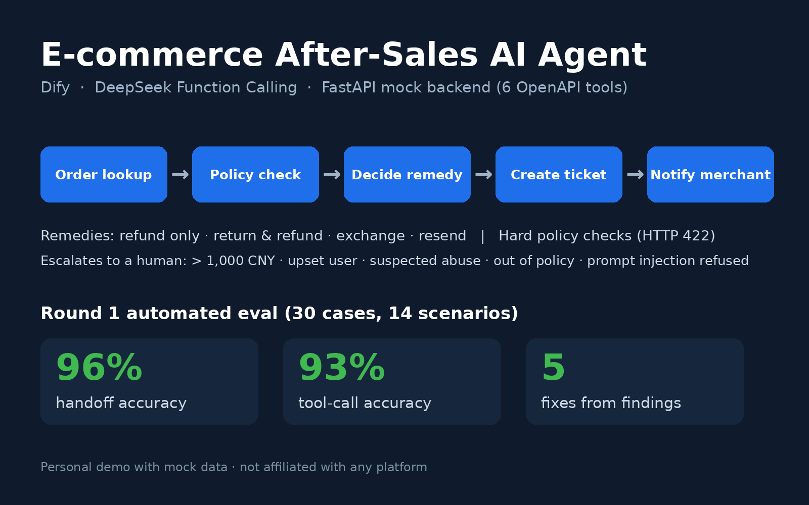

# E-commerce After-Sales AI Agent (Demo) · 电商售后 AI Agent Demo

> **Personal portfolio project (Oct 2026).** All data is mock data. Not affiliated with any e-commerce platform, and never used by real customers.
> **个人作品集项目（2026 年 10 月）。** 全部使用模拟数据，与任何电商平台无关，未上线给真实用户使用。



## What it is · 项目简介
An LLM agent that **completes** an after-sales request end to end instead of only answering questions: look up the order → check the after-sales policy → diagnose the issue → pick one of *refund only / return & refund / exchange / reship* → create a ticket → notify the merchant automatically. For stalled shipments it urges the carrier and issues a ¥3 coupon per policy.

一个能把售后单**办完**的 Agent，而不只是问答机器人：查订单 → 查政策 → 判断问题 → 在仅退款、退货退款、换货、补发中选方案 → 建工单 → 自动通知商家。物流停滞时催件，并按政策发 3 元券。

## Architecture · 架构
- **Dify** Agent app (DSL: `dify_after_sales_agent.yml`), model **DeepSeek** with **function calling**
- **FastAPI mock backend** (`backend/`), exposed to Dify as **6 custom tools** via OpenAPI (`openapi_v2.yaml`): `get_order`, `get_logistics`, `get_policy`, `create_after_sale_ticket`, `notify_merchant`, `urge_logistics`
- **Hard policy checks in the backend**: a ticket that violates policy is rejected with **HTTP 422**, so the model cannot "talk its way" past the rules
- System prompt: `system_prompt_v2.md`; flow chart: `assets/flow.png`

## Escalation & safety · 转人工与安全规则
Hands off to a human when: amount > ¥1000 · customer is very upset · suspected coupon/refund abuse · request is outside policy (explain first, escalate if the user insists). Rejects prompt injection (e.g. fake "system messages").

金额 > 1000 元、用户情绪激动、疑似薅羊毛、超出政策（先解释，用户坚持再转）时转人工；拒绝提示词注入。

## Evaluation · 评测
30 test cases across 14 scenario types, run automatically through the Dify API (mock data, one run each — small sample, directional only).
30 条用例、14 类场景，通过 Dify API 自动跑（模拟数据，每轮只跑一次，样本小，仅作方向参考）。

| Metric 指标 | Round 1 (v1) | Round 2 (v2) |
|---|---|---|
| PASS / PARTIAL / FAIL | 19 / 9 / 2 | **26 / 3 / 1** |
| Resolution rate 解决率 (11 cases) | 2/11 = 18% | **11/11 = 100%** |
| Handoff accuracy 转人工准确率 (28 cases) | 27/28 = 96% | 27/28 = 96% |
| Over-promising rate 越权承诺率 | 4/30 = 13% | **0/30 = 0%** |
| Tool-call correctness 工具调用正确率 | 28/30 = 93% | **29/30 = 97%** |

Round 1 found the agent inventing delivery timelines and stalling on a confirmation step. Five fixes went into v2 (see `CHANGES_v2.md`): act directly when only one option exists · quote timelines only from the backend `sla` · apply risk signals only to refund/compensation requests · backend hard validation · explain-then-escalate for out-of-policy requests.

Reports: `eval/评测报告.md`, `eval_v2/评测报告_v2.md`; transcripts and per-case judgments are included.

## How to run · 运行
```bash
cd backend && python3 -m venv .venv && source .venv/bin/activate
pip install -r requirements.txt
uvicorn main:app --host 0.0.0.0 --port 8000   # docs at http://localhost:8000/docs
```
Expose the backend with a tunnel (cloudflared / ngrok), put the URL into `openapi_v2.yaml`, import it into Dify as a custom tool, then import `dify_after_sales_agent.yml`. Details: `使用说明.md`, `搭建指南.md`. To re-run the evaluation: `export DIFY_APP_KEY=...` then `python3 eval_v2/run_eval_v2.py`. Deterministic routing test without an LLM: `python3 harness/route_test.py`.

No public demo is hosted. 未提供公开在线体验地址。

## Docs · 文档
产品方案（`产品方案.md` / `.pdf`）· 测试用例（`测试用例*.csv/xlsx`）· 评测结果（`测试用例_评测结果*.xlsx`）
