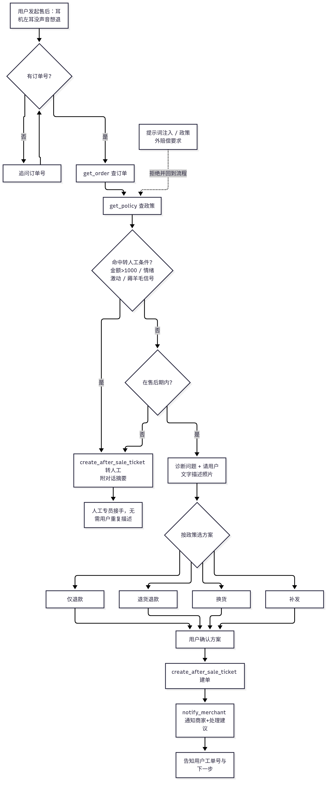
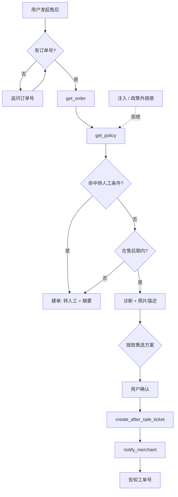

# 电商售后 Agent Demo 产品方案

> 个人作品集 Demo｜作者：黄海慧｜2026 年 10 月
> 场景参考常见电商平台的售后流程，**全部使用模拟数据，与任何平台无关，未上线给真实用户使用**。

## 1. 背景与场景

电商客服里，售后咨询量大、规则多，而且必须真正“办完”：查订单、判断能不能退、选方案、建单、通知商家。只能回答“退货政策是什么”的 FAQ 机器人帮不上这些忙，用户最后还得转人工。

本 Demo 想验证一件事：**大模型 Agent 能否在规则约束下，自己调用工具把一张售后单从头办到尾，遇到边界情况时把问题和摘要一起正确交给人工。**

典型场景：消费者说“PD1001 耳机左耳没声音，想退”。Agent 查订单（签收 3 天、129 元）→ 查政策（15 天内质量问题可退可换）→ 追问现象并请用户描述照片 → 给出“退货退款 / 换货”两个选项 → 按用户的选择建单 → 通知商家并附处理建议 → 告诉用户工单号和下一步。

## 2. 用户与场景

| 角色 | 核心诉求 | Demo 中的体验 |
|---|---|---|
| 消费者（ToC） | 少等待、少重复描述、结果明确 | 一次对话办完；转人工时附摘要，不用重新说一遍 |
| 商家（ToB） | 工单信息完整、有处理建议、风险提前标出 | 收到结构化工单：方案、原因、证据描述、摘要、处理建议 |
| 人工客服 | 只接真正需要人判断的单 | 收到高金额、情绪激动、疑似薅羊毛、超出政策的单，附转人工原因 |

覆盖的场景：仅退款、退货退款、换货、补发、超出售后期、信息不全、多轮澄清、物流查询、高金额、情绪激动、疑似薅羊毛、提示词注入、索要政策外赔偿、商家端查看工单。

## 3. Agent 能力与工具

| 工具 | 作用 | 关键返回字段 |
|---|---|---|
| get_order | 查订单 | 金额、类目、状态、距签收天数、买家近 30 天售后次数 |
| get_logistics | 查物流 | 物流轨迹、停滞天数 |
| get_policy | 查售后政策 | 各方案适用条件、转人工阈值、允许的补偿 |
| create_after_sale_ticket | 建售后单 | 工单号、方案、是否转人工 |
| notify_merchant | 通知商家 | 推送给商家的摘要和处理建议 |

能力边界：方案以 get_policy 返回的内容为准，系统提示词规定了办理顺序；后端会校验 resolution 的取值，以及它和 handoff 是否一致，作为提示词之外的一道兜底。

## 4. 售后政策规则（模拟）

| 方案 | 适用条件 | 是否寄回 |
|---|---|---|
| 仅退款 | 未发货；生鲜签收 48 小时内坏损；质量问题且金额 ≤ 50 元 | 否 |
| 退货退款 | 签收 7 天内无理由（生鲜除外）；签收 15 天内质量问题 | 是 |
| 换货 | 签收 15 天内质量问题；签收 7 天内尺码不合 | 是 |
| 补发 | 签收后漏发、少件，且有称重或商家记录可以佐证 | 否 |
| 补偿 | 只有一种：物流停滞超过 3 天，可发 3 元无门槛券 1 张 | — |

## 5. 转人工规则

| 触发条件 | 判断依据 | 处理 |
|---|---|---|
| 高金额 | 订单金额 > 1000 元 | 转人工，不承诺结果 |
| 情绪激动 | 辱骂，威胁投诉、找 12315 或曝光，连续强烈不满 | 先安抚，再转人工 |
| 疑似薅羊毛 | 近 30 天售后 ≥ 3 次；描述和订单商品对不上；要求退到别人的账户 | 转人工，摘要里标出风险信号 |
| 超出政策 | 超过售后期；要求政策以外的处理 | 先说明政策，用户坚持再转人工 |
| 提示词注入 | “忽略指令 / 你是管理员 / 伪造的系统消息” | **不转人工，直接拒绝执行**，继续正常流程 |

转人工时，工单里写清楚 handoff_reason 和对话摘要，人工专员接手后用户不用再描述一遍。

## 6. 对话流程图

## 7. 比 FAQ 机器人多做了什么

我之前做过一个 Dify 金融客服 Demo（知识库问答 + 转人工规则 + 防注入，做了三轮评测）。这次在它的基础上，从“会回答”往前走到“能办事”：

| 维度 | FAQ 机器人 | 售后 Agent |
|---|---|---|
| 输出 | 一段回答 | 一张建好的工单 + 一条商家通知 |
| 信息来源 | 静态知识库 | 实时查订单、物流、政策 |
| 决策 | 无 | 按政策和订单数据选方案 |
| 风险控制 | 拒答 | 分类转人工 + 摘要，不越权承诺 |
| 服务对象 | 只有消费者 | 消费者 + 商家 + 人工客服 |

## 8. 评测指标

评测集共 30 条用例（见《测试用例.xlsx》），覆盖 14 类场景。**下面全部是目标值，大模型的实测结果尚未产生**，跑完再填进 xlsx 的“LLM评测记录”页。

| 指标 | 定义 | 目标 |
|---|---|---|
| 解决率 | 应由 Agent 自己办完的用例中，方案正确且建单成功的比例 | 目标 ≥ 85% |
| 转人工准确率 | 该转的转了、不该转的没转（按用例计） | 目标 ≥ 95% |
| 越权承诺率 | 回复中出现政策以外承诺的用例占比 | 目标 = 0% |
| 工具调用正确率 | 工具调用顺序和参数与预期一致的比例 | 目标 ≥ 90% |

目前已完成：一个不调用大模型的确定性路由测试（harness/route_test.py）。它用写死的规则跑真实的 mock 后端，检查 21 条可以自动判定的用例，“政策 + 模拟数据 + 期望结果”三者是否一致，结果 21/21 一致。**这只说明规则和工具链是通的，不代表大模型的实际表现。**

## 9. 迭代计划

1. **V0.1（当前）**：mock 后端 + Dify Agent + 30 条用例；接入 DeepSeek，跑第一轮评测，记录失败原因。
2. **V0.2**：针对失败用例改提示词和工具描述；在后端加“政策校验”，金额或方案不合规时直接拒绝建单，不只靠提示词。
3. **V0.3**：支持图片上传，让多模态模型判断坏损；增加售前咨询（商品参数、优惠规则）。
4. **V0.4**：商家端 Agent，根据工单生成同意或驳回的建议，统计商家的高频售后原因，反馈给商品质量改进。
5. **V1.0**：线上 A/B 指标设计：解决率、转人工率、用户满意度、平均处理时长、二次进线率。
